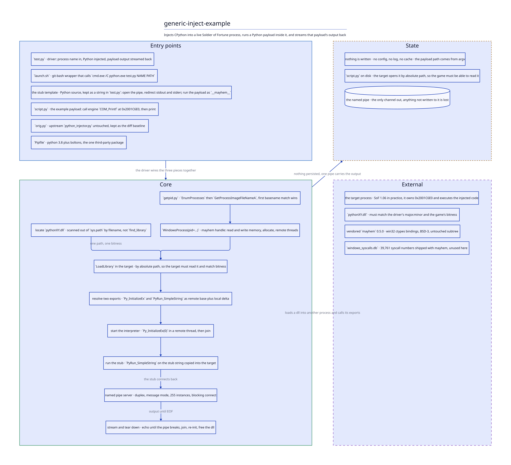

# generic-inject-example

A working example of injecting CPython into a live Soldier of Fortune process, running a Python payload inside it, and getting that payload's output back on your terminal — the front half of every "script the game from Python" idea in this folder.

Read it left to right:

- **It is mayhem's `python_injector.py` with three small edits.** `orig.py` is the untouched upstream file, kept so you can diff them: the process argument became a process *name*, the pipe name became six random letters instead of the fixed `mayhem`, and the `ExitThread` at the end of the stub is commented out. Everything under `mayhem/` is the vendored 0.5.0 library, BSD-3, not this repo's code.
- **The payload only exists when injected.** The driver runs it with `run_name='__mayhem__'`, so `script.py` falls through to "this script must be injected" when executed normally. What it then does is the SoF-specific part: call `COM_Printf` at the hardcoded address 0x2001C6E0. There is no module-base lookup, so that address is a bet on one specific game build — anywhere else it corrupts whatever happens to live there.
- **The trick is that no export is looked up remotely.** After `LoadLibrary` returns a remote handle, the driver computes `remote_base + (local_export - local_base)` for `Py_InitializeEx` and `PyRun_SimpleString`. That only works because it is the same dll file mapped at a different address, and it means there is no `GetProcAddress` call, no PE parsing and no shellcode in the target.
- **The dll is chosen by filename, not by the loader.** `ctypes.util.find_library` is replaced with a scan of `sys.path` for `pythonXY.dll`, and the path is then loaded *into the game*, so the game must be able to read that path and the dll must match the game's bitness — a 64-bit Python against 32-bit SoF fails at `LoadLibrary`, not at import.
- **Teardown is the unfinished part.** `Py_FinalizeEx` is resolved and printed but never called; after the pipe closes, `test.py` re-runs `Py_InitializeEx` (the comment literally asks "wait for python interpreter to be calm?") and frees the library, leaving the target in an undefined state. The overlapped-pipe flags are also commented out in `test.py` but not in `orig.py`, so `ConnectNamedPipe` blocks: if the stub never connects, the driver hangs instead of erroring.

Diagram source: [`docs/system.d2`](docs/system.d2) · renderer: [`scripts/render-diagram.sh`](scripts/render-diagram.sh).
